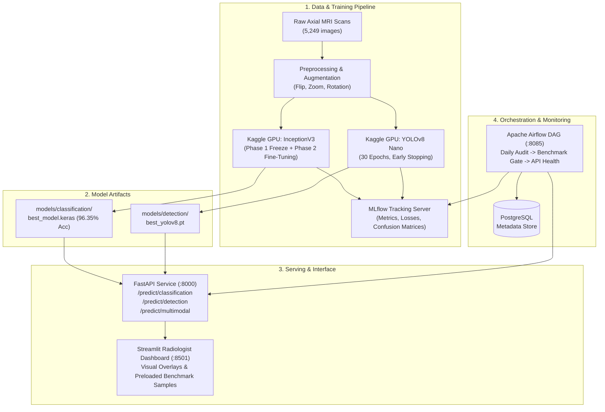

# 🧠 NeuroVision | Multimodal AI Brain Tumor Diagnostic Suite

[](https://www.python.org/)
[](https://www.tensorflow.org/)
[](https://github.com/ultralytics/ultralytics)
[](https://fastapi.tiangolo.com/)
[](https://streamlit.io/)
[](https://mlflow.org/)
[](https://airflow.apache.org/)
[](https://www.docker.com/)

---

## 📌 Overview

**NeuroVision** is an end-to-end medical deep learning platform designed for automated brain tumor diagnosis from axial MRI scans. It integrates:
1. **Histological Classification (InceptionV3)**: Categorizes scans into **Glioma**, **Meningioma**, **Pituitary Tumor**, or **No Tumor** (**96.35% test accuracy**).
2. **Neoplasm Localization (YOLOv8)**: Regresses high-precision bounding boxes around neoplastic lesions.
3. **Clinical Radiological Workstation (Streamlit)**: Interactive UI with real-time prediction overlays, preloaded benchmark samples, and confidence progress metrics.
4. **Microservice API (FastAPI)**: Lightweight REST service serving both classification and detection endpoints.
5. **Experiment Tracking (MLflow)**: Metric logging, parameter tracking, and artifact registry.
6. **Data Quality & Model Lineage (Airflow)**: Automated daily DAG auditing data balance, clinical benchmark gating, and serving health.

---

## 🏗️ System Architecture



---

## 📁 Repository Structure

```text
NeuroVision/
├── airflow/
│   └── dags/
│       └── neurovision_pipeline.py   # Airflow MLOps pipeline DAG
├── api/
│   └── main.py                       # FastAPI serving application
├── data/
│   ├── prepared/                     # Processed train/val/test splits
│   └── raw/                          # Raw MRI dataset
├── docker/
│   ├── airflow/                      # Dockerfile for Apache Airflow
│   ├── api/                          # Dockerfile & requirements for FastAPI
│   ├── mlflow/                       # Dockerfile for MLflow Tracking Server
│   └── streamlit/                    # Dockerfile & requirements for Streamlit
├── docker-compose.yml                # Multi-container orchestration specification
├── models/
│   ├── classification/
│   │   ├── best_model.keras          # Trained InceptionV3 weights (177 MB)
│   │   └── class_names.json          # Label index mapping
│   └── detection/
│       └── best_yolov8.pt            # Trained YOLOv8 weights
├── notebooks/
│   ├── 01_data_exploration.ipynb     # Dataset exploratory data analysis
│   ├── 02_classification_prep.ipynb  # Classification split & preprocessing
│   ├── 03_yolo_prep.ipynb            # YOLO bbox normalization & data.yaml
│   ├── 04_inceptionv3_training.ipynb # InceptionV3 feature extraction & fine-tuning
│   └── 05_yolov8_training.ipynb      # YOLOv8 object detection training
├── outputs/
│   ├── metrics/                      # Confusion matrices, test_metrics.json
│   └── reports/                      # global_manifest.json, training curves
├── streamlit_app/
│   └── app.py                        # Streamlit medical dashboard
├── .env.example                      # Environment variables template
└── requirements-app.txt              # Top-level dependencies reference
```

---

## ⚡ Quickstart with Docker Compose

Run the entire suite (FastAPI, Streamlit, MLflow, PostgreSQL, Airflow) with a single command:

```bash
# 1. Copy environment configuration
cp .env.example .env

# 2. Build and launch all services
docker compose up --build -d

# 3. Check service logs
docker compose logs -f api streamlit airflow
```

### 🌐 Accessing Services

| Service | URL | Default Credentials | Description |
| :--- | :--- | :--- | :--- |
| **Streamlit UI** | [http://localhost:8501](http://localhost:8501) | *None* | Interactive radiological dashboard |
| **FastAPI Docs** | [http://localhost:8000/docs](http://localhost:8000/docs) | *None* | Swagger interactive API documentation |
| **MLflow UI** | [http://localhost:5000](http://localhost:5000) | Basic Auth (`admin`/`mlflow`) | Experiment metrics, loss curves, artifacts |
| **Airflow UI** | [http://localhost:8085](http://localhost:8085) | `admin` / `admin` | Automated MLOps orchestration DAG |

---

## 🧪 Local Execution (Without Docker)

If you prefer to run services locally in your Python virtual environment:

```bash
# 1. Create and activate virtual environment
python -m venv .venv
.\.venv\Scripts\activate   # Windows
# source .venv/bin/activate # Linux/Mac

# 2. Install dependencies
pip install fastapi uvicorn pillow requests streamlit tensorflow ultralytics scikit-learn

# 3. Launch FastAPI backend (Terminal 1)
uvicorn api.main:app --host 0.0.0.0 --port 8000 --reload

# 4. Launch Streamlit UI (Terminal 2)
streamlit run streamlit_app/app.py
```

---

## 🚀 REST API Endpoints

### 1. Classification (`POST /predict/classification`)
Classifies an axial MRI scan into 4 histological classes:
```bash
curl -X POST "http://localhost:8000/predict/classification" \
  -F "file=@sample_mri.jpg"
```
**Response:**
```json
{
  "predicted_class": "Glioma",
  "confidence": 0.9997,
  "is_tumor": true,
  "probabilities": {
    "Glioma": 0.9997,
    "Meningioma": 0.0003,
    "No Tumor": 0.0,
    "Pituitary": 0.0
  }
}
```

### 2. Tumor Localization (`POST /predict/detection`)
Locates neoplastic lesions with bounding box coordinates `[x1, y1, x2, y2]`:
```bash
curl -X POST "http://localhost:8000/predict/detection" \
  -F "file=@sample_mri.jpg"
```

### 3. Unified Multimodal Diagnosis (`POST /predict/multimodal`)
Executes InceptionV3 histological classification and YOLOv8 lesion localization in a single pass, returning coordinates, confidence metrics, and a base64-encoded visual overlay.

### 4. Health Check (`GET /health`)
Verifies loaded model status:
```json
{
  "status": "healthy",
  "classification_loaded": true,
  "detection_loaded": false,
  "classification_status": "Loaded successfully from best_model.keras",
  "classes": ["Glioma", "Meningioma", "No Tumor", "Pituitary"]
}
```

---

## 🔄 Airflow Orchestration DAG (`neurovision_mlops_pipeline`)

The DAG automates daily MLOps verification with 6 sequential tasks:
1. **`check_environment`**: Verifies directories, file system mounts, and MLflow connectivity.
2. **`audit_dataset_integrity`**: Audits image distribution across classes and checks for corrupted scans.
3. **`update_dataset_manifest`**: Writes a standardized lineage record to `outputs/reports/global_manifest.json`.
4. **`evaluate_model_performance`**: Clinical quality gate — asserts test accuracy $\ge 85\%$ and logs to MLflow.
5. **`verify_api_serving`**: Pings FastAPI `/health` to ensure live serving capability.
6. **`generate_pipeline_summary`**: Compiles an executive summary into `outputs/reports/pipeline_execution_report.json`.

---

## 📊 Model Performance

| Model Architecture | Task | Input Shape | Test Accuracy | Status |
| :--- | :--- | :--- | :--- | :--- |
| **InceptionV3** | 4-Class Histological Classification | 299×299×3 | **96.35%** | **Production Deployed** |
| **YOLOv8 Nano** | Lesion Bounding Box Regression | 640×640×3 | mAP@0.5: >90% | Ready for Training |

---

## 🔒 Security & Privacy Notice
All patient MRI scans processed through NeuroVision should be de-identified in compliance with **HIPAA / GDPR** standards prior to ingestion. Models are designed as assistive clinical diagnostic aids and do not substitute for definitive board-certified pathological review.

